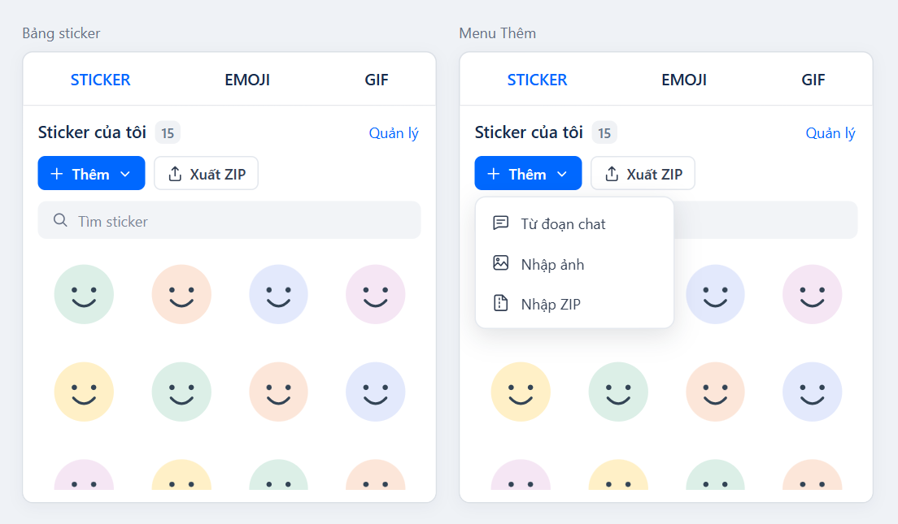

# Zalo Sticker

**Bộ sticker cá nhân ngay trong bảng sticker của Zalo PC.**

Zalo Sticker, còn gọi là GiaoLang Sticker, thêm mục **★ Sticker của tôi** vào giao diện Zalo PC. Bạn có thể lấy ảnh đã gửi từ iPhone, nhập ảnh trên máy và xuất cả bộ thành ZIP để chia sẻ với bạn bè.

Đây là tiện ích không chính thức, không do Zalo/VNG phát triển hoặc bảo trợ.



*Minh họa giao diện bằng dữ liệu mẫu; không sử dụng ảnh hoặc lịch sử chat của người dùng.*

## Tính năng

- **Tích hợp vào bảng sticker:** mở biểu tượng sticker trong Zalo, chọn **★** rồi bấm ảnh để gửi.
- **Thêm từ đoạn chat:** chọn ảnh đã hiển thị trong cuộc trò chuyện hiện tại để lưu vào bộ riêng.
- **Nhập ảnh PNG/JPEG:** ảnh tĩnh được chuyển sang WebP; giữ nền trong suốt nếu ảnh gốc có nền trong suốt.
- **Tìm kiếm và quản lý:** tìm theo tên, bỏ sticker khỏi bộ cá nhân.
- **Xuất/nhập ZIP:** chia sẻ ảnh thật trong một tệp, phát hiện ảnh trùng khi nhập.
- **Lưu theo tài khoản trên máy:** bộ sticker được giữ trong IndexedDB của Zalo.
- **Cài và gỡ có sao lưu:** kiểm tra phiên bản trước khi vá, sao lưu chương trình gốc và hỗ trợ khôi phục.

## Phiên bản hỗ trợ

| Thành phần | Yêu cầu |
| --- | --- |
| Bản vá hiện tại | **0.2.1** |
| Zalo PC | **26.11.12**, mã thành phần khớp bản đã kiểm tra |
| Bộ cài độc lập | Windows x64; đã thử trên Windows 11 |
| Máy chỉ sử dụng bộ cài | Không cần Python, Node.js hoặc npm |

**Không áp dụng cho mọi phiên bản Zalo.** Trình cài từ chối thay tệp nếu phiên bản hoặc mã thành phần không khớp. Zalo tự cập nhật có thể làm bản vá mất hiệu lực; cần kiểm tra và bổ sung hỗ trợ cho phiên bản mới.

## Cài đặt bằng bộ cài độc lập

1. Mở mục [Releases](https://github.com/longurara/zalo_sticker/releases) và tìm tệp `GiaoLangSticker-0.2.1-Windows-x64.zip`. Nếu chưa có bản phát hành đính kèm, xem phần [tự đóng gói](#tự-đóng-gói-bộ-cài).
2. Giải nén toàn bộ ZIP vào một thư mục.
3. Trong Zalo PC, chọn **Cài đặt → Thoát**. Dấu **X** có thể chỉ thu nhỏ ứng dụng xuống khay hệ thống.
4. Chạy `install.cmd`, hoặc mở PowerShell tại thư mục vừa giải nén và chạy:

```powershell
.\install.cmd
```

5. Mở lại Zalo → bảng **Sticker** → **★**.

Giữ các tệp `.cmd` và `GiaoLangStickerPatch.exe` cùng thư mục. Với Zalo cài trong tài khoản người dùng, thông thường không cần quyền quản trị.

### Các lệnh đi kèm

| Lệnh | Chức năng |
| --- | --- |
| `install.cmd` | Cài hoặc cập nhật bản vá |
| `status.cmd` | Xem phiên bản đang cài và phiên bản công cụ |
| `uninstall.cmd` | Gỡ bản vá, khôi phục chương trình Zalo gốc |

Kiểm tra trước khi cài, không thay tệp:

```powershell
.\GiaoLangStickerPatch.exe install --dry-run
```

Nếu Zalo được cài ở vị trí khác hoặc có nhiều bản cài:

```powershell
.\GiaoLangStickerPatch.exe install --archive "D:\Zalo\Zalo-26.11.12\resources\app.asar"
```

## Dùng sticker đã tạo trên iPhone

1. Trên iPhone, gửi các sticker muốn dùng vào **Cloud của tôi** trong Zalo.
2. Trên PC, mở **Cloud của tôi**, cuộn đến khi các ảnh đó hiển thị trong đoạn chat.
3. Mở bảng sticker → **★ → Thêm → Từ đoạn chat**.
4. Bấm **+** ở từng ảnh để thêm vào bộ, sau đó bấm **Xong**.
5. Mở cuộc trò chuyện muốn gửi và chọn sticker trong bộ cá nhân.

Bước thêm ảnh vào bộ không gửi tin nhắn. Nếu không đọc được ảnh từ đoạn chat, tải ảnh về máy rồi chọn **Thêm → Nhập ảnh**.

> Bản vá không tự xuất toàn bộ kho nhãn dán iOS và không tự tách nền lại cho ảnh đã bị làm phẳng nền.

## Chia sẻ bộ sticker bằng ZIP

### Xuất bộ của bạn

Mở **★ → Xuất ZIP**. Ứng dụng tạo tệp `sticker-cua-toi.zip`; bạn có thể gửi tệp này cho bạn bè.

Gói ZIP chứa ảnh thật, tên sticker, kích thước và SHA-256 để kiểm tra dữ liệu. Gói không chứa ID tài khoản, ID tin nhắn, cookie, lịch sử chat hoặc URL CDN của người xuất. Nội dung hình ảnh do bạn chọn vẫn được giữ nguyên.

Nếu ảnh nguồn không đọc được, ứng dụng báo lỗi thay vì âm thầm xuất một bộ thiếu ảnh. Hãy bổ sung ảnh gốc trước khi thử lại.

### Nhập bộ từ bạn bè

Người nhận cần cài bản vá tương thích, sau đó mở **★ → Thêm → Nhập ZIP** và chọn gói được chia sẻ. Sticker mới được thêm vào bộ hiện có; ảnh trùng nội dung được bỏ qua. Thao tác nhập không tự gửi tin nhắn.

| Giới hạn mỗi gói | Giá trị |
| --- | --- |
| Số sticker | Tối đa **200** |
| Kích thước mỗi ảnh | Tối đa **10 MB** |
| Tổng dung lượng ảnh giải nén | Tối đa **100 MB** |

Chức năng nhập ZIP nhận định dạng gói do Zalo Sticker xuất, không phải ZIP ảnh bất kỳ.

## Gỡ bản vá và khôi phục Zalo

Thoát hẳn Zalo, rồi chạy:

```powershell
.\uninstall.cmd
```

Hoặc dùng trực tiếp chương trình:

```powershell
.\GiaoLangStickerPatch.exe restore
```

Công cụ kiểm tra bản sao lưu rồi khôi phục `app.asar` gốc. **Gỡ bản vá không xóa bộ sticker đã lưu và không đổi tài khoản Zalo.**

Bản sao lưu chương trình và thông tin cài đặt nằm trong:

```text
%LOCALAPPDATA%\GiaoLangStickerPatch\<mã thư mục cài>\
```

Giữ thư mục này khi còn cần khôi phục. Bộ sticker được lưu trong dữ liệu cục bộ của Zalo; nên xuất ZIP trước khi xóa dữ liệu ứng dụng hoặc chuyển máy.

## Phát triển từ mã nguồn

### Chuẩn bị

- **Node.js 22 trở lên** và npm để kiểm tra JavaScript.
- **Python 3.10 trở lên** để kiểm tra trình cài; bản đóng gói hiện tại dùng Python 3.12 x64.
- Bản Zalo PC được hỗ trợ nếu muốn tạo ASAR để kiểm tra tích hợp.

```powershell
git clone https://github.com/longurara/zalo_sticker.git
cd zalo_sticker
npm ci
npm run check
npm test
python -m unittest discover -s tests -p test_portable.py -v
```

Các kiểm tra ZIP và trình cài dùng dữ liệu mẫu, không cần tài khoản Zalo và không gửi tin nhắn. Khi chưa có ASAR đã tạo, những kiểm tra tích hợp phụ thuộc ASAR sẽ được đánh dấu bỏ qua kèm lý do.

### Tạo ASAR và kiểm tra tích hợp

Trên máy có bản Zalo tương thích:

```powershell
npm run patch:build
npm test
```

Lệnh build chỉ tạo tệp trong `build/`, không cài đè lên Zalo. Có thể chỉ định đường dẫn nguồn và đầu ra:

```powershell
python tools/portable.py build `
  --archive "D:\Zalo\Zalo-26.11.12\resources\app.asar" `
  --output ".\build\app-26.11.12-giaolang.asar"
```

Cài từ mã nguồn sau khi đã thoát Zalo:

```powershell
npm run patch:install
npm run patch:status
```

Khôi phục:

```powershell
npm run patch:restore
```

### Tự đóng gói bộ cài

Thực hiện trên Windows với Python x64:

```powershell
python -m pip install -r requirements-build.txt
npm run release:build
```

Kết quả nằm trong `dist/`:

```text
GiaoLangSticker-0.2.1-Windows-x64.zip
GiaoLangSticker-0.2.1-Windows-x64.zip.sha256
```

Bộ ZIP chỉ đóng gói chương trình cài/gỡ, hướng dẫn và thông tin giấy phép; không kèm Zalo gốc hoặc sticker cá nhân. `dist/`, `build/`, các bản sao ASAR và dữ liệu thử nghiệm không được đưa vào Git.

### Cấu trúc dự án

```text
src/                     Giao diện sticker, gửi ảnh và định dạng gói ZIP
tools/patch.py           Đọc/ghi ASAR, kiểm tra mã và áp dụng thay đổi
tools/portable.py        Tìm Zalo, cài, gỡ, kiểm tra và build
tools/package_release.py Đóng gói chương trình Windows và ZIP phát hành
tests/                   Kiểm tra ZIP, trình cài và tích hợp ASAR
vendor/fflate/           Thư viện ZIP kèm giấy phép
distribution/            Hướng dẫn được kèm trong bộ cài
docs/images/             Ảnh minh họa bằng dữ liệu mẫu
```

## Giới hạn hiện tại

- Đây là bộ sticker cá nhân trên máy, không phải bộ đã đăng vào kho sticker công khai của Zalo.
- Luồng ảnh tĩnh được kiểm tra bằng dữ liệu mẫu. Sticker động/GIF, cách chuyển tiếp và hiển thị phía người nhận cần được kiểm chứng với nội dung cụ thể.
- URL ảnh Zalo có thể hết hạn. Khả năng đọc lại ảnh phụ thuộc ảnh gốc và bản ảnh đã lưu cục bộ.
- Mỗi phiên bản Zalo mới cần được kiểm tra riêng; không tự vá theo phỏng đoán chỉ dựa vào tên phiên bản.

## Xử lý lỗi thường gặp

| Thông báo hoặc hiện tượng | Cách xử lý |
| --- | --- |
| Zalo đang chạy | Chọn **Cài đặt → Thoát**, sau đó chạy lại lệnh |
| Không tìm thấy Zalo / có nhiều bản cài | Dùng `--archive` để chỉ đúng `resources/app.asar` |
| Phiên bản hoặc mã không khớp | Dừng cài; gửi phiên bản Zalo qua Issues để kiểm tra hỗ trợ |
| Không có quyền ghi | Kiểm tra quyền ghi vào thư mục cài Zalo; bộ cài không tự nâng quyền |
| Không thấy ảnh khi lấy từ chat | Cuộn đến ảnh trong đoạn chat rồi thử lại, hoặc tải ảnh về để nhập |
| Không xuất được ZIP vì thiếu ảnh | Bổ sung lại ảnh gốc rồi xuất lại |
| Bản sao lưu bị thiếu hoặc hỏng | Giữ nguyên tệp hiện tại; công cụ sẽ từ chối ghi đè khi không xác minh được bản gốc |

## Đóng góp và báo lỗi

Tạo [Issue](https://github.com/longurara/zalo_sticker/issues) kèm phiên bản Zalo PC, phiên bản bản vá, phiên bản Windows và các bước tái hiện. Nếu đính kèm ảnh chụp hoặc thông báo lỗi, hãy bỏ thông tin đăng nhập và nội dung chat riêng tư.

Pull request nên mô tả thay đổi, cách kiểm tra và phiên bản Zalo liên quan. Không đưa chương trình Zalo, bản sao tài khoản hoặc bộ sticker cá nhân vào repository.

## Giấy phép và thành phần bên thứ ba

Mã dự án hiện chưa công bố giấy phép sử dụng riêng (`UNLICENSED`). Thư viện **fflate 0.8.3** giữ giấy phép MIT; xem [THIRD_PARTY_NOTICES.md](THIRD_PARTY_NOTICES.md) và [giấy phép gốc](vendor/fflate/LICENSE).
